# Using Agent Skills

## Overview

This repository (`Bert0ns/agent-skills`) is a curated collection of production-grade engineering workflow skills for coding agents (Antigravity, Claude Code, Cursor, Codex, Windsurf, Gemini CLI), indexed on [skills.sh](https://skills.sh/).

Each skill encodes a disciplined process, standard, or automation workflow. This meta-skill routes incoming requests to the appropriate skill across every phase of development.

---

## Skill Discovery & Routing

When a task arrives, identify the development intent and invoke the matching skill:

```mermaid
flowchart TD
    Task([Task Arrives]) --> Intent{What is the primary intent?}

    %% Ideation & Scoping
    Intent -->|Need to clarify vague idea| Idea[idea-refine]
    Intent -->|Stress-test thinking / assumptions| Grill[grill-me / grilling]
    Intent -->|Setup / optimize agent context & memory| Context[context-engineering]
    Intent -->|Compress agent conversation / save tokens| Cave[caveman]

    %% Architecture & Design
    Intent -->|Reverse-engineer system design & C4 docs| SysDocs[system-design-docs]
    Intent -->|Audit module depth & refactor structure| ArchSmells[improve-codebase-architecture]
    Intent -->|Keep implementation minimal / YAGNI / lazy senior dev| Pony[ponytail]
    Intent -->|Strict TypeScript patterns & boundary types| TS[typescript-best-practices]

    %% Code Quality & Review
    Intent -->|Distributed multi-agent repository audit| DistAudit[distributed-code-audit]
    Intent -->|Standards & spec compliance review| Review[code-review]
    Intent -->|Strict maintainability & abstraction review| Thermo[thermo-nuclear-code-quality-review]
    Intent -->|Strip accidental abstraction & simplify logic| Simplify[code-simplification]
    Intent -->|Security audit, auth verification, OWASP| Sec[security-and-hardening]
    Intent -->|Clean AI code boilerplate & comments| Deslop[deslop]
    Intent -->|Strip AI tells & sycophancy from prose| Unslop[unslop]

    %% Implementation & Testing
    Intent -->|Test-driven red-green-refactor loop| TDD[tdd]

    %% Frontend & Mobile
    Intent -->|Design distinctive, non-generic UI| FrontDesign[frontend-design]
    Intent -->|Audit UI against Web Interface Guidelines / a11y| WebGuide[web-design-guidelines]
    Intent -->|React / Next.js performance & composition| ReactRules[vercel-react-best-practices]
    Intent -->|React Native / Expo lists & animations| NativeRules[vercel-react-native-skills]
```

---

## Available Skills by Category

### 1. Ideation, Scoping & Context
- **`idea-refine`**: Clarifies concepts through structured divergent and convergent thinking.
- **`grill-me`**: Relentless Socratic interview engine to stress-test plans before implementation.
- **`grilling`**: Core interrogation engine backing `grill-me`.
- **`context-engineering`**: Curates active file sets, rules, and token budgets to prevent context saturation.
- **`caveman`**: Terse communication voice that cuts conversational fluff and saves up to 65% output tokens while preserving technical facts.

### 2. Architecture & Engineering Practices
- **`system-design-docs`**: Orchestrates modular C4-aligned system design documentation (`docs/architecture/`) via parallel subagent extraction and verified Mermaid diagrams.
- **`improve-codebase-architecture`**: Scans for shallow modules and produces interactive HTML architectural improvement reports.
- **`ponytail`**: Lazy senior developer mode enforcing YAGNI, standard library reuse, minimal diffs, and anti-overengineering.
- **`typescript-best-practices`**: Enforces strict typed boundaries, runtime validation, and domain modeling.
- **`tdd`**: Disciplined test-driven development loop (red-green-refactor).

### 3. Code Quality, Review & Anti-Slop
- **`distributed-code-audit`**: Partitions large codebases across parallel dual-persona review agents and generates an interactive HTML scorecard dashboard.
- **`code-review`**: Dual-pass review checking repository coding standards and original specification adherence.
- **`code-simplification`**: Reduces unnecessary abstractions and complexity while strictly preserving exact runtime behavior.
- **`security-and-hardening`**: Threat modeling (STRIDE), OWASP Top 10 auditing, auth checks, and dependency risk mitigation.
- **`thermo-nuclear-code-quality-review`**: Ultra-strict review for tangled conditionals, monolithic files, and leaky abstractions.
- **`deslop`**: Post-generation cleanup removing AI boilerplate, repetitive comments, and defensive clutter.
- **`unslop`**: Prose review cutting filler words, sycophantic phrasing, and decorative patterns.

### 4. Frontend, Design Systems & Mobile
- **`frontend-design`**: Visual hierarchy, typography, and color guidance to avoid generic AI layout defaults.
- **`web-design-guidelines`**: Audits web interfaces for accessibility (WCAG), keyboard navigation, and UX patterns.
- **`vercel-react-best-practices`**: React/Next.js data fetching, caching, streaming, and server component rules.
- **`vercel-react-native-skills`**: React Native and Expo performance patterns (lists, animations, native bridges).

---

## Core Operating Behaviors

These principles govern agent execution across all skills:

1. **Surface Assumptions Early:**
   State non-obvious assumptions before executing multi-file changes. Give the user an opportunity to correct course before rework is needed.

2. **Manage Confusion Actively:**
   When encountering contradictory requirements or confusing code, **stop and ask**. Do not guess or silently paper over discrepancies.

3. **Push Back When Warranted:**
   Avoid sycophancy. If a requested pattern introduces security vulnerabilities, severe performance regressions, or architectural debt, explain the concrete tradeoff and propose an alternative.

4. **Enforce Simplicity & YAGNI:**
   The cleanest code is code that was never written. Do not add speculative options, premature generalizations, or unnecessary helper layers.

5. **Maintain Scope Discipline:**
   Touch only what the task requires. Do not perform unsolicited refactoring of adjacent code or delete comments you do not yet understand.

6. **Verify with Evidence:**
   Every task requires verification (tests passing, linter/typecheck clean, build succeeding, or runtime validation). Never claim a task is complete based on assumptions alone.

---

## Typical Lifecycle Combinations

Skills are modular and can be chained:

* **New Feature:** `idea-refine` → `grill-me` → `ponytail` / `tdd` → `code-simplification` → `deslop`
* **Large Codebase Health Check:** `distributed-code-audit` → `improve-codebase-architecture` → `security-and-hardening`
* **Documenting / Auditing System Architecture:** `system-design-docs` (generates modular C4 blueprints)
* **Frontend Overhaul:** `frontend-design` → `web-design-guidelines` → `vercel-react-best-practices`
* **Fast Terminal Iteration:** Activate `caveman` to keep conversation concise and save tokens during lengthy debug sessions.
