# Using agent skills

## Overview

This repository (`Bert0ns/agent-skills`) contains engineering skills for coding agents, indexed on [skills.sh](https://skills.sh/). Compatible agents include Antigravity, Claude Code, Cursor, Codex, Windsurf, and Gemini CLI.

This skill routes incoming tasks to the matching skill for each stage of development.

---

## Skill discovery and routing

When a task arrives, identify the primary goal and invoke the matching skill:

```mermaid
flowchart TD
    Task([Task arrives]) --> Intent{What is the primary goal?}

    %% Ideation and scoping
    Intent -->|Clarify vague idea| Idea[idea-refine]
    Intent -->|Test assumptions| Grill[grill-me / grilling]
    Intent -->|Manage context and token limits| Context[context-engineering]
    Intent -->|Trim conversation tokens| Cave[caveman]

    %% Architecture and design
    Intent -->|Extract C4 architecture docs| SysDocs[system-design-docs]
    Intent -->|Find shallow modules| ArchSmells[improve-codebase-architecture]
    Intent -->|Keep changes minimal and avoid extra abstractions| Pony[ponytail]
    Intent -->|TypeScript types and boundary checks| TS[typescript-best-practices]

    %% Code quality and review
    Intent -->|Multi-agent repository audit| DistAudit[distributed-code-audit]
    Intent -->|Check coding standards and spec| Review[code-review]
    Intent -->|Audit file size and conditionals| Thermo[thermo-nuclear-code-quality-review]
    Intent -->|Simplify logic and remove extra abstractions| Simplify[code-simplification]
    Intent -->|Security audit and vulnerability checks| Sec[security-and-hardening]
    Intent -->|Remove AI code slop and clutter| Deslop[deslop]
    Intent -->|Remove AI tells from writing| Unslop[unslop]

    %% Implementation and testing
    Intent -->|Test-driven development| TDD[tdd]

    %% Frontend and mobile
    Intent -->|UI visual hierarchy and styling| FrontDesign[frontend-design]
    Intent -->|Audit UI accessibility and guidelines| WebGuide[web-design-guidelines]
    Intent -->|React and Next.js performance| ReactRules[vercel-react-best-practices]
    Intent -->|React Native and Expo patterns| NativeRules[vercel-react-native-skills]
```

---

## Available skills by category

### 1. Ideation, scoping, and context

- `idea-refine`. Clarifies concepts through structured divergent and convergent thinking.
- `grill-me`. Interviews the user to test assumptions before implementation starts.
- `grilling`. Core question engine used by `grill-me`.
- `context-engineering`. Curates active file sets, rules, and token budgets to keep context within limits.
- `caveman`. Strips conversational filler and saves tokens while preserving technical facts.

### 2. Architecture and engineering practices

- `system-design-docs`. Extracts system architecture into C4 diagrams and markdown documents under `docs/architecture/` using subagents.
- `improve-codebase-architecture`. Scans for shallow modules and produces an interactive HTML report.
- `ponytail`. Favors minimal diffs, standard libraries, and simple solutions without extra abstractions.
- `typescript-best-practices`. Enforces strict typed boundaries, runtime validation, and domain modeling.
- `tdd`. Runs test-driven development cycles with red-green-refactor steps.

### 3. Code quality, review, and anti-slop

- `distributed-code-audit`. Partitions large codebases across parallel review agents and generates an interactive HTML scorecard.
- `code-review`. Runs two review passes to check repository coding standards and specification requirements.
- `code-simplification`. Simplifies logic and removes unnecessary abstractions while preserving behavior.
- `security-and-hardening`. Performs threat modeling, OWASP checks, authentication verification, and dependency audits.
- `thermo-nuclear-code-quality-review`. Audits code for bloated files, tangled conditionals, and leaky abstractions.
- `deslop`. Removes AI boilerplate, repetitive comments, and unnatural defensive checks from code.
- `unslop`. Edits prose to remove AI writing patterns, filler phrases, and sycophantic tone.

### 4. Frontend, design systems, and mobile

- `frontend-design`. Guides visual hierarchy, typography, and color palettes to avoid generic default styling.
- `web-design-guidelines`. Audits web interfaces for accessibility, keyboard navigation, and layout consistency.
- `vercel-react-best-practices`. Applies performance and composition rules for React and Next.js applications.
- `vercel-react-native-skills`. Applies performance patterns for React Native and Expo, with an emphasis on lists and animations.

---

## Core operating behaviors

These rules govern agent execution across all skills:

1. **Surface assumptions early.** State non-obvious assumptions before making multi-file changes so the user can correct course before rework begins.
2. **Clarify confusion.** When encountering contradictory requirements or unclear code, stop and ask. Do not guess or silently patch over discrepancies.
3. **Push back with tradeoffs.** If a requested change introduces security flaws, performance regressions, or unnecessary complexity, explain the tradeoff and propose an alternative.
4. **Prefer simplicity.** Build only what the task requires. Do not add speculative configuration options, premature generalizations, or unused helper layers.
5. **Maintain scope discipline.** Touch only the files needed for the task. Do not refactor adjacent code without asking or delete comments you do not understand.
6. **Verify with evidence.** Verify every change with concrete evidence such as passing tests, clean type checks, successful builds, or runtime validation. Do not mark a task complete without verification.

---

## Common workflows

Skills can be combined for specific workflows:

- **New feature.** Clarify scope with `idea-refine`, test assumptions with `grill-me`, write minimal code with `ponytail` or `tdd`, simplify logic with `code-simplification`, and remove AI clutter with `deslop`.
- **Codebase health check.** Run `distributed-code-audit` for a multi-agent review, inspect module depth with `improve-codebase-architecture`, and review vulnerabilities with `security-and-hardening`.
- **Architecture documentation.** Run `system-design-docs` to extract system architecture into C4 diagrams and markdown documents.
- **Frontend overhaul.** Establish visual guidelines with `frontend-design`, verify accessibility with `web-design-guidelines`, and optimize performance with `vercel-react-best-practices`.
- **Low-token terminal work.** Turn on `caveman` to keep responses brief during long debugging sessions.
